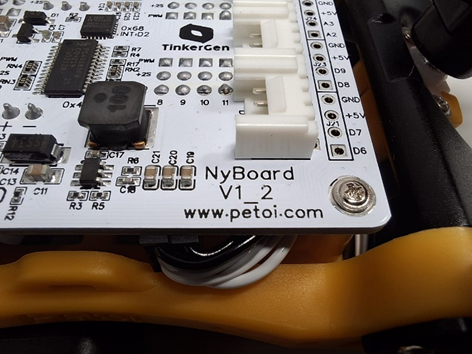
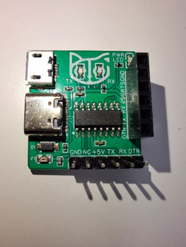
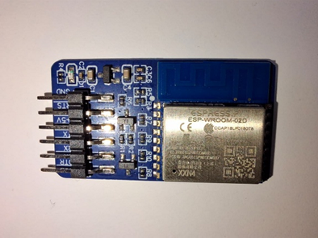
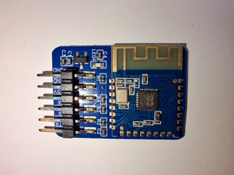
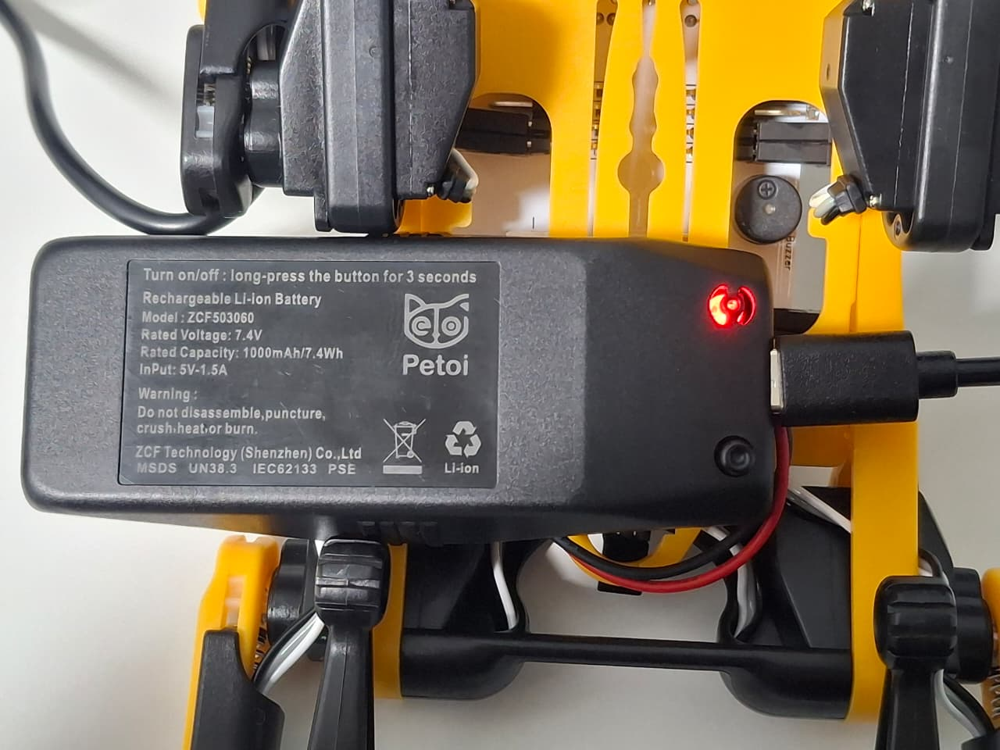

# Requerimientos iniciales
## Identificación Hardware
### Verificar Versión de la placa


### Módulo de conexión USB


### Módulo de conexión WiFi


### Módulo de conexión Bluetooth



## Funcionamiento del entorno (Windows)
### Preparación de la API de Python

1. Instalar Python (versión > 3.6) o Anaconda (versión > 3). Anaconda ya posee una terminal, en caso de instalarse, verificar cómo utilizar una terminal. 

    Si ya se tiene instalado Python verificar versión, ejecutar:
    ```
    python --version
    ```

    Si se tiene instalado Anaconda, buscar Anaconda Prompt en el menú de inicio y ejecutar:

    ```
    conda --version
    ```

2. Instalar librería pyserial, desde el CMD:
    ```
    pip install pyserial
    ```

3. Correr el archivo de python ubicado en:
    ```
    ...\OpenCat-Quadruped-Robot-main\OpenCat-Quadruped-Robot-main\OpenCatPythonAPI\demos\petoiRobotExample.py
    ```


### Prueba de carga y descarga de la batería
- Indicadores
    --
    - Luz roja: Batería baja.
    - Luz azul: Batería totalmente cargada o encendida.
    
    


- Tiempos de carga y descarga
    --
    - Se estima una tiempo de carga de 1:30 hrs para una carga completa, desde el puerto USB de una laptop.

    - Se estima un tiempo de descarga de 1:30 hrs con carga completa y uso moderado.


### Archivos necesarios para pruebas básicas
Para las primeras pruebas, haciendo uso de comunicación serial y envío de rutinas predefinidas, se deben utilizar los siguientes archivos de python, incluidos en el repositorio oficial de OpenCat y extraídos del mismo:

#### Archivos necesarios
----
```
C:...\OpenCat-Quadruped-Robot-main\OpenCat-Quadruped-Robot-main\serialMaster> 

ardSerial.py
config.py
SerialCommunication.py
testSkills.py
```

```
C:...\OpenCat-Quadruped-Robot-main\OpenCat-Quadruped-Robot-main\pyUI> 

translate.py
```

En este respositorio, se incluye un archivo para pruebas en el que se dejan comentadas las líneas utilizadas para este cometido. En este archivo se concentra el uso de los documentos antes mencionados.

```
C:...\OpenCat-Quadruped-Robot-main\OpenCat-Quadruped-Robot-main\pyUI> 

test1.py
```
