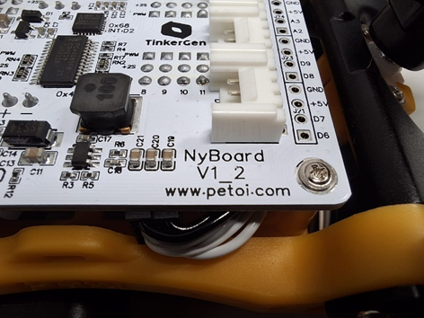
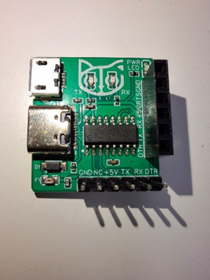
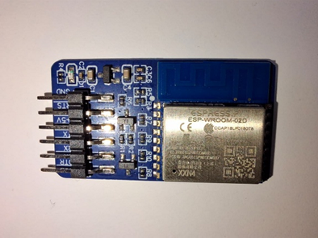
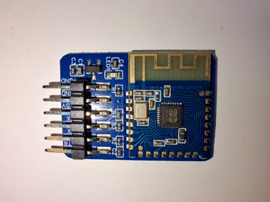

# Requerimientos iniciales
## Identificar complementos para funcionamiento
### Verificar Versión de la placa

### Módulo de conexión USB

### Módulo de conexión WiFi

### Módulo de conexión Bluetooth
